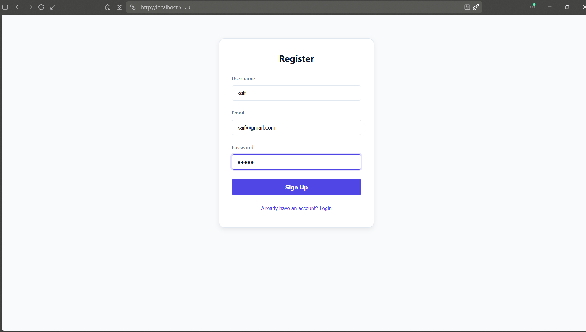
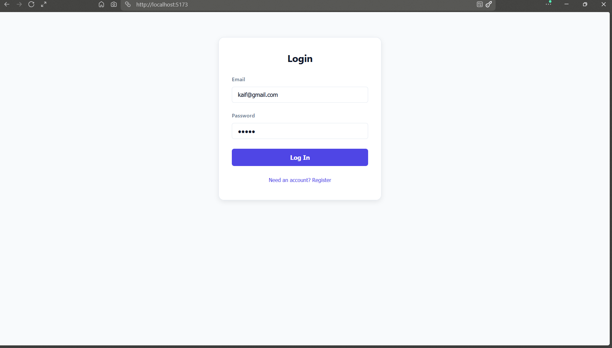
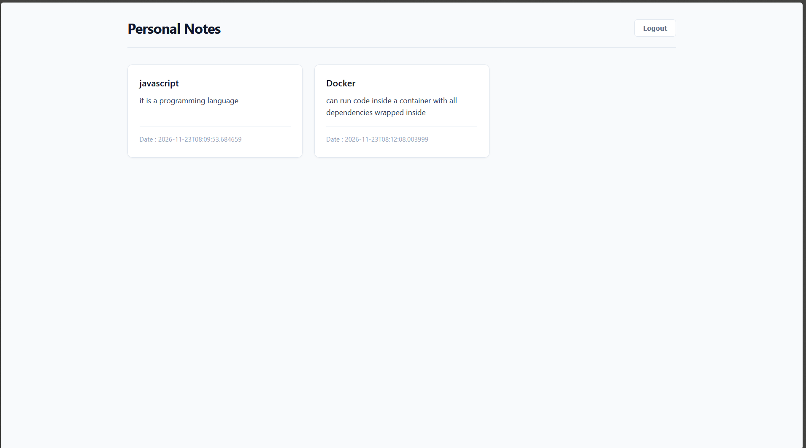
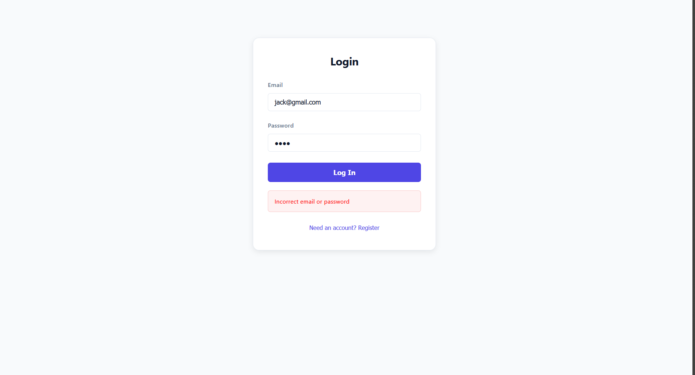
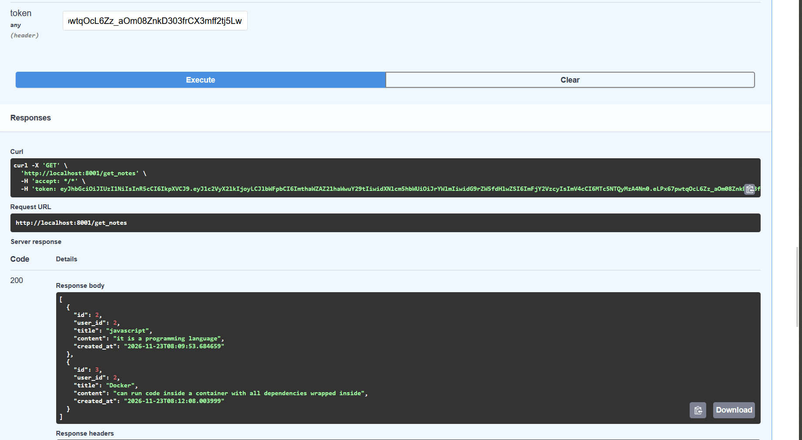
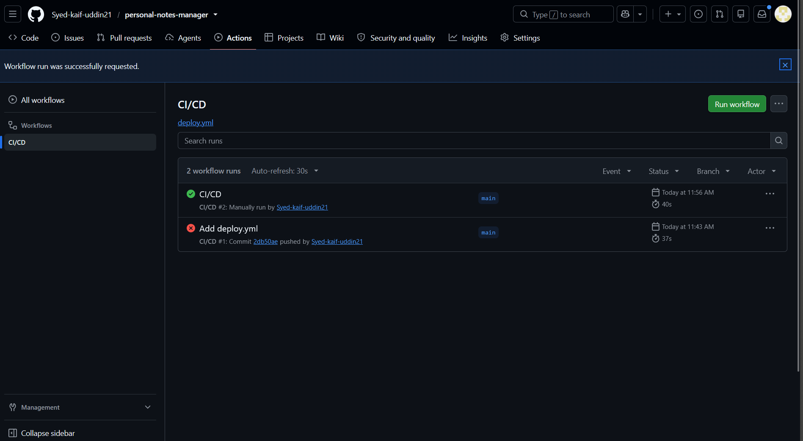

# Personal Notes Manager

A full-stack personal notes management web application built with a **FastAPI + SQLite** backend and a **React + Vite** frontend.

---

## 1. Project and Team

- **Project Name:** Personal Notes Manager (`personal-notes-manager`)
- **Team Members:** Shahibha, Sanika, Kaif

### Team Members & Endpoint Distribution

| Member Name | Role / Focus | Endpoints & Modules Built | Description |
|:---|:---|:---|:---|
| **Shahibha** | Backend | **A1**, **A2**, **main.py** | `POST /register` (User registration with Argon2 password hashing)<br>`POST /login` (User authentication & JWT token generation)<br>`main.py` (FastAPI app routing & CORS configuration) |
| **Sanika** | Backend | **A3**, **E1**, **E2** | `POST /refresh` (Generate new access token using refresh token)<br>`GET /notes` (Fetch all personal notes for the authenticated user)<br>`POST /notes` (Create a new personal note linked to `user_id`) |
| **Kaif** | Backend, Frontend & DevOps | **functions.py**, **App.jsx**, **login.jsx**, **NoteCard.jsx**, CI/CD | `functions.py` (Database models, JWT logic, Argon2 hashing)<br>React Frontend UI (`App.jsx`, `login.jsx`, `NoteCard.jsx`)<br>Docker containerization (`Dockerfile`) & GitHub Actions EC2 deployment |

---

## 2. Live App

- **Live Application / API Base URL:**  
  [http://15.207.112.95::8001](http://15.252.243.198:8001)

- **Interactive Swagger Documentation:**  
  [http://15.207.112.95::8001/docs](http://15.252.243.198:8001/docs)

---

## 3. How to Run It

### Run Backend (FastAPI)

1. Navigate to the backend directory:
   ```bash
   cd backend
   ```

2. Create and activate a virtual environment:
   ```bash
   python -m venv .venv
   # Windows (PowerShell):
   .\.venv\Scripts\Activate.ps1
   # macOS/Linux:
   source .venv/bin/activate
   ```

3. Install required dependencies:
   ```bash
   pip install -r requirements.txt
   ```

4. Run the FastAPI development server:
   ```bash
   uvicorn main:app --reload --port 8001
   ```
   > Swagger UI Docs will be available at: `http://localhost:8001/docs`

---

### Run Frontend (React + Vite)

1. Navigate to the frontend directory:
   ```bash
   cd frontend
   ```

2. Install dependencies:
   ```bash
   npm install
   ```

3. Start the Vite development server:
   ```bash
   npm run dev
   ```
   > The application will be running at: `http://localhost:5173`

---

### Run with Docker

To build and run the backend service inside a Docker container:

1. Build the Docker image from the project root:
   ```bash
   docker build -t personal-notes-manager:v1 .
   ```

2. Run the Docker container with persistent SQLite volume mounting:
   ```bash
   docker run -d --name personal-notes-manager \
     --restart unless-stopped \
     -p 8001:8001 \
     -v $(pwd)/notes-data/notes.db:/app/notes.db \
     personal-notes-manager:v1
   ```

3. Access the interactive documentation at `http://localhost:8001/docs`.

---

## 4. API Contract

### Completed Endpoints Table (A1–A3, E1–E2)

| # | What it does | Method | Path | Request Body / Headers | Success Code | Who Built |
|:---:|:---|:---:|:---|:---|:---:|:---:|
| **A1** | Register a new user | `POST` | `/register` | **JSON Body:**<br>`{"username": "kaif", "email": "kaif@example.com", "password": "password123"}` | `201` | Shahibha |
| **A2** | Login and generate JWT access and refresh tokens | `POST` | `/login` | **JSON Body:**<br>`{"email": "kaif@example.com", "password": "password123"}` | `200` | Shahibha |
| **A3** | Generate a new access token using a refresh token | `POST` | `/refresh` | **JSON Body:**<br>`{"refresh_token": "<refresh_token>"}`<br>*(or Header: `token: <refresh_token>`)* | `200` | Sanika |
| **E1** | Get all notes belonging to the logged-in user | `GET` | `/notes` *(or `/get_notes`)* | **Header:** `token: <access_token>`<br>*(or `Authorization: Bearer <access_token>`)*<br>**Body:** *None* | `200` | Sanika |
| **E2** | Create a new note and associate it with the logged-in user | `POST` | `/notes` *(or `/create_note`)* | **Header:** `token: <access_token>`<br>*(or `Authorization: Bearer <access_token>`)*<br>**JSON Body:**<br>`{"title": "My Note", "content": "Note description here"}` | `201` | Sanika |

---

### Error Rules Table

| Rule | HTTP Status | Detail Message Example |
|:---|:---:|:---|
| Registering with an email that already exists | `409` | `{"detail": "Email already exists"}` |
| Logging in with incorrect email or password | `401` | `{"detail": "Incorrect email or password"}` |
| Using an invalid or expired access token | `401` | `{"detail": "Using an invalid or expired access token"}` |
| Using an invalid or expired refresh token | `401` | `{"detail": "Invalid or expired refresh token"}` |
| Accessing notes without authentication | `401` | `{"detail": "Accessing notes without authentication"}` |
| Sending missing or empty required fields | `422` | `{"detail": "Title and content are required"}` |
| Registering with an invalid email format | `422` | `{"detail": "Invalid email format"}` |

---

## 5. Database

The database is an SQLite database file called `notes.db` with two tables:

### Table 1: `users`
Stores registered user accounts and hashed authentication credentials.

| Column | Type | Constraints | Description |
|:---|:---|:---|:---|
| `id` | `INTEGER` | PRIMARY KEY, AUTOINCREMENT | Unique user identifier |
| `username` | `VARCHAR` | NOT NULL | Display name / username |
| `email` | `VARCHAR` | UNIQUE, NOT NULL | User's unique email address |
| `hashed_password` | `VARCHAR` | NOT NULL | Argon2 salted password hash |
| `created_at` | `DATETIME` | DEFAULT CURRENT_TIMESTAMP | Account creation timestamp |

### Table 2: `notes`
Stores personal notes belonging to each user.

| Column | Type | Constraints | Description |
|:---|:---|:---|:---|
| `id` | `INTEGER` | PRIMARY KEY, AUTOINCREMENT | Unique note identifier |
| `user_id` | `INTEGER` | FOREIGN KEY (`users.id`), NOT NULL | ID of the user who owns this note |
| `title` | `VARCHAR` | NOT NULL | Title of the personal note |
| `content` | `TEXT` | NOT NULL | Body content of the note |
| `created_at` | `DATETIME` | DEFAULT CURRENT_TIMESTAMP | Note creation timestamp |

---

## 6. Screenshots

### Screenshot 1: User Registration
  
*User registration form allowing new users to sign up with username, email, and password.*

---

### Screenshot 2: User Login
  
*Login interface validating user credentials and issuing JWT access and refresh tokens.*

---

### Screenshot 3: Notes Dashboard
  
*Personal Notes Dashboard displaying all notes belonging to the logged-in user in responsive cards.*

---

### Screenshot 4: Error Handling on Screen
  
*User interface displaying validation and authentication error banners upon invalid input or credentials.*

---

### Screenshot 5: Working Endpoint in Swagger `/docs`
  
*FastAPI interactive Swagger UI (`/docs`) showing successful endpoint execution with 200/201 responses.*

---

### Screenshot 6: Green GitHub Actions CI/CD Run
  
*Successful automated GitHub Actions workflow building the Docker image and deploying to AWS EC2.*

---

## 7. Project Features & Architecture

1. **JWT Authentication & Security**:
   - Access tokens (short-lived) and Refresh tokens (long-lived) using HMAC SHA-256 (`HS256`).
   - Secure Argon2 password hashing with salting before saving to SQLite database.
2. **User Data Isolation**:
   - Every note is linked to a user via `user_id`. Users can only retrieve and access their own notes.
3. **Automated CI/CD Deployment**:
   - GitHub Actions pipeline triggers on push to `main`.
   - Builds and tags the Docker image, pushes to Docker Hub, and connects to AWS EC2 via SSH to redeploy the updated container.
   - Persistent SQLite volume mount ensures database records remain intact across redeployments.
